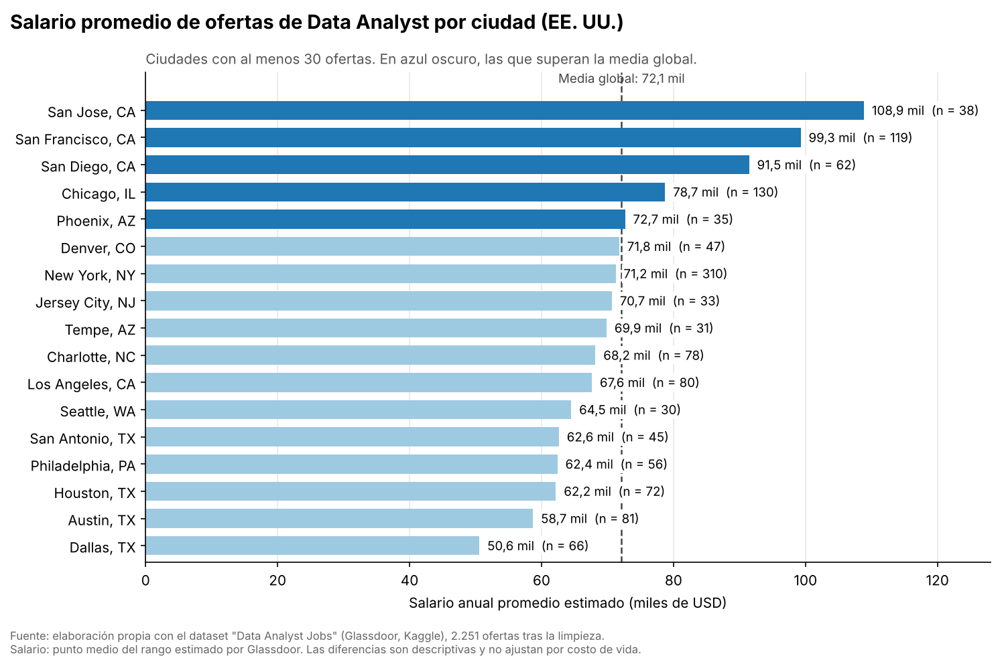

  

  

# Hola, soy Jean 👋
 
Estudio la Licenciatura en Ciencia de Datos. Lo que más me gusta es tomar datos desordenados, entender qué cuentan y explicarlo claro, sin hacerles decir más de lo que dicen. Antes me formé como programador en la UTN, así que también sé construir sistemas que alguien usa de verdad.
 
Mi primer sistema de punto de venta lo usan varios comercios. Desde ahí me quedó una costumbre: antes de escribir código, pregunto cómo trabaja la persona que lo va a usar.
 

 
- Publiqué mi primer análisis completo con datos públicos: diez años de ingresos laborales en Argentina con la EPH del INDEC.
- Trabajo como pasante de automatización y datos en CAMEES, de forma remota: depuro bases, armo validaciones con Apps Script y planillas de seguimiento.
- Estoy armando un sistema de facturación electrónica conectado a ARCA.
- Busco mi primer puesto como trainee en ciencia o análisis de datos, o como desarrollador .NET junior.

 

**[Ingresos laborales en Argentina, 2017–2026](https://github.com/Jean5011/eph-ingresos-laborales-argentina)**
Mi proyecto de datos más completo. Analicé diez años de la Encuesta Permanente de Hogares del INDEC (369.946 personas) para ver cómo cambiaron los ingresos según la edad, el nivel educativo y la región. Ajusté todo por inflación, usé los ponderadores oficiales y solo di por sólido un cambio cuando la media y la mediana coincidían. Lo que encontré: después de la cuarentena hay más empleo y menos desempleo, pero quienes trabajan ganan alrededor de un 16 % menos en términos reales.
`Python` `Pandas` `NumPy` `Matplotlib` `Google Colab`

 
**[Auditoría del mercado laboral tech](https://github.com/Jean5011/Auditoria_mercado_laboral_tech)**
Tomé un dataset público con más de 2.200 ofertas de empleo tech, bastante desordenado, y lo convertí en una base relacional. Limpié los salarios con expresiones regulares, cargué todo en SQLite y respondí con SQL qué sectores y ciudades pagan más. Solo comparé grupos con al menos 30 ofertas, para no sacar conclusiones de muestras chicas.
`Python` `Pandas` `Regex` `SQLite` `SQL`

 
**[AI Creative Studio](https://github.com/Jean5011/ai-creative-studio-guia)**
Lo construí en el taller de Nerdearla siguiendo el codelab de Google ([material original de Saoussen-CH](https://github.com/Saoussen-CH/mas-a2a-gcp)). Son 6 agentes de IA que arman una campaña de Instagram completa a partir de una sola instrucción. Desplegué los agentes en Cloud Run y aprendí mucho resolviendo errores de permisos leyendo logs.
`Python` `Google ADK` `Gemini` `A2A` `MCP` `Cloud Run`

 

 
**[Inventario Kiosco](https://github.com/Jean5011/Inventario-Kiosco-)**
Punto de venta e inventario de escritorio. Tiene más de 15 módulos y lo usan varios clientes. Uso transacciones en SQL Server para que el stock no se descuadre en los cierres con mucho movimiento, y las contraseñas se guardan con hashing PBKDF2. Lee códigos de barras e imprime tickets en impresoras térmicas.
`C#` `.NET 10` `WPF` `Dapper` `SQL Server`
 
**[Mis finanzas](https://github.com/Jean5011/mis-finanzas)** · [Probar la app](https://mis-finanzas-916528.webflow.io/)
Calculadora de ingresos y egresos que hice para el App Challenge de Webflow en Nerdearla 2026. El balance se actualiza al instante, un gráfico compara lo que entra y lo que sale por categoría, y todo se descarga en Excel o PDF. Las librerías de exportación se cargan recién al tocar el botón de descarga, así la página abre más rápido.
`Next.js` `React` `TypeScript` `Webflow Cloud`
 
**[Sistema de búsqueda laboral](https://github.com/Jean5011/Sistema-de-b-squeda-laboral)**
Lo hice para mi propia búsqueda de trabajo. Revisa 6 bolsas de empleo al mismo tiempo, descarta las ofertas repetidas y puntúa cada una según cuánto se ajusta a un perfil .NET junior.
`C#` `.NET 8` `WPF` `MVVM`
 
**[Sistema de ventas](https://github.com/Jean5011/Sistema-Venta)**
Facturación y gestión comercial de escritorio, con procedimientos almacenados y reportes RDLC.
`C#` `.NET Framework` `Windows Forms` `SQL Server`
 
**[Presupuesto](https://github.com/Jean5011/https-Jean5011.github.io-Presupuesto)**
App web para llevar ingresos y gastos y ver el balance en tiempo real.
`JavaScript` `HTML` `CSS`
 
**[Juego de la serpiente](https://github.com/Jean5011/SnakeGame)**
El Snake clásico en consola, con velocidad que aumenta y registro de puntajes. Lo hice por diversión.
`C#` `.NET Framework`

 

 
| Proyecto | Qué es | Stack |
|---|---|---|
| [Tienda de mascotas web](https://github.com/Jean5011/Tienda_de_mascotas_web) | Gestión de ventas para una tienda de mascotas (grupal) | C# |
| [Concesionario](https://github.com/Jean5011/Concesionario_final) | Gestión de compra y venta de vehículos | C++ |
| [Proyecto banco](https://github.com/Jean5011/Proyecto-banco) | Proyecto académico | Java |
| [TP Integrador](https://github.com/Jean5011/TP_Integrador) | Proyecto académico | Java |
| [Programación 3](https://github.com/Jean5011/TP_Programacion_3) | Trabajos prácticos de la materia | C# |

 

 
**Datos**
 

 
**Desarrollo**
 

 
**Herramientas**
 

 
**Google Workspace**
 

 

 
Antes de programar a tiempo completo pasé dos años en soporte técnico, resolviendo problemas de red por teléfono. Ahí aprendí a explicar cosas técnicas sin vueltas. También di clases de Sistemas Operativos y Programación Orientada a Objetos en la Universidad de Pilar, a grupos de entre 30 y 70 alumnos.

 

 

  
  

<code>&gt; fin de la transmisión_</code>

 
